# UML de clases — BlockBreaker

```mermaid
classDiagram
    direction TB

    class ApplicationAdapter {
        <<libGDX>>
        +create() void
        +render() void
        +dispose() void
    }

    class ShapeRenderer {
        <<libGDX>>
    }
    class OrthographicCamera {
        <<libGDX>>
    }
    class SpriteBatch {
        <<libGDX>>
    }
    class BitmapFont {
        <<libGDX>>
    }

    class BlockBreakerGame {
        -OrthographicCamera camera
        -SpriteBatch batch
        -BitmapFont font
        -ShapeRenderer shape
        -PingBall ball
        -Paddle pad
        -ArrayList~Block~ blocks
        -GameManager gestor
        +create() void
        +crearBloques(int filas) void
        +dibujaTextos() void
        +render() void
        +dispose() void
    }

    class Renderizable {
        <<interface>>
        +draw(ShapeRenderer shape) void
    }

    class Block {
        <<abstract>>
        -int x
        -int y
        -int width
        -int height
        -Color cc
        -boolean destroyed
        +draw(ShapeRenderer shape) void
        +recibirGolpe() void
        +setColor(Color color) void
        +setDestroyed(boolean destroyed) void
        +isDestroyed() boolean
    }

    class NormalBlock {
        +recibirGolpe() void
    }

    class HardBlock {
        -int vidas
        +recibirGolpe() void
    }

    class Paddle {
        -int x
        -int y
        -int width
        -int height
        +draw(ShapeRenderer shape) void
    }

    class PingBall {
        -int x
        -int y
        -int size
        -int xSpeed
        -int ySpeed
        -boolean estaQuieto
        -BallMovement estrategia
        +update() void
        +draw(ShapeRenderer shape) void
        +setEstrategia(BallMovement estrategia) void
        +checkCollision(Paddle paddle) void
        +checkCollision(Block block) void
    }

    class GameManager {
        <<Singleton>>
        -GameManager instancia
        -int vidas
        -int puntaje
        -int nivel
        -GameManager()
        +getInstancia() GameManager
        +getVidas() int
        +getPuntaje() int
        +getNivel() int
        +perderVida() void
        +sumarPunto() void
        +siguienteNivel() void
        +reiniciarPartida() void
    }

    class BallMovement {
        <<interface>>
        +calcularDesplazamiento(int velocidad) int
    }
    class NormalMovement {
        +calcularDesplazamiento(int velocidad) int
    }
    class FastMovement {
        +calcularDesplazamiento(int velocidad) int
    }

    class Level {
        <<abstract>>
        +crearNivel(int ancho, int alto) ArrayList~Block~
        +crearNivel(int ancho, int alto, ConfiguracionNivel config) ArrayList~Block~
        #obtenerFilas() int
        #crearBloque(int fila, int x, int y, int ancho, int alto) Block
    }
    class EasyLevel {
        #obtenerFilas() int
        #crearBloque(int fila, int x, int y, int ancho, int alto) Block
    }
    class HardLevel {
        #obtenerFilas() int
        #crearBloque(int fila, int x, int y, int ancho, int alto) Block
    }

    class ConfiguracionNivel {
        -int filas
        -int filasResistentes
        -int anchoBloque
        -int altoBloque
        +getFilas() int
        +getFilasResistentes() int
        +getAnchoBloque() int
        +getAltoBloque() int
    }
    class ConfiguracionNivelBuilder {
        <<Builder>>
        -int filas
        -int filasResistentes
        -int anchoBloque
        -int altoBloque
        +filas(int filas) ConfiguracionNivelBuilder
        +filasResistentes(int filasResistentes) ConfiguracionNivelBuilder
        +anchoBloque(int anchoBloque) ConfiguracionNivelBuilder
        +altoBloque(int altoBloque) ConfiguracionNivelBuilder
        +build() ConfiguracionNivel
    }

    ApplicationAdapter <|-- BlockBreakerGame

    Renderizable <|.. Block
    Renderizable <|.. PingBall
    Renderizable <|.. Paddle
    Block <|-- NormalBlock
    Block <|-- HardBlock

    BallMovement <|.. NormalMovement
    BallMovement <|.. FastMovement
    PingBall --> BallMovement : estrategia

    Level <|-- EasyLevel
    Level <|-- HardLevel
    Level ..> Block : crea
    Level ..> ConfiguracionNivel : utiliza
    ConfiguracionNivelBuilder ..> ConfiguracionNivel : build

    BlockBreakerGame --> GameManager : instancia unica
    BlockBreakerGame *-- PingBall
    BlockBreakerGame *-- Paddle
    BlockBreakerGame o-- "0..*" Block : bloques
    BlockBreakerGame ..> Level : crea niveles
    BlockBreakerGame ..> ConfiguracionNivelBuilder : configura

    BlockBreakerGame --> OrthographicCamera
    BlockBreakerGame --> ShapeRenderer
    BlockBreakerGame --> SpriteBatch
    BlockBreakerGame --> BitmapFont
```

## Lectura del diagrama

- **Herencia:** `NormalBlock` y `HardBlock` extienden `Block`; `EasyLevel` y `HardLevel` extienden `Level`.
- **Interfaces:** `Renderizable` la implementan `Block`, `PingBall` y `Paddle`; `BallMovement` la implementan `NormalMovement` y `FastMovement`.
- **Singleton:** `GameManager` concentra vidas, puntaje y nivel.
- **Strategy:** `PingBall` usa una estrategia de movimiento intercambiable.
- **Template Method:** `Level` fija el procedimiento de creación de bloques y sus subclases personalizan los bloques normales.
- **Builder:** `ConfiguracionNivelBuilder` prepara la configuración que usa `Level`.
- **libGDX:** `BlockBreakerGame` extiende `ApplicationAdapter` y utiliza objetos para dibujo, cámara y texto.

> El diagrama representa las relaciones principales del código compartido; omite algunos métodos auxiliares para mantenerlo legible.
