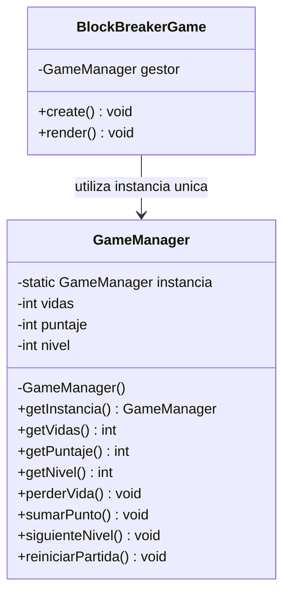
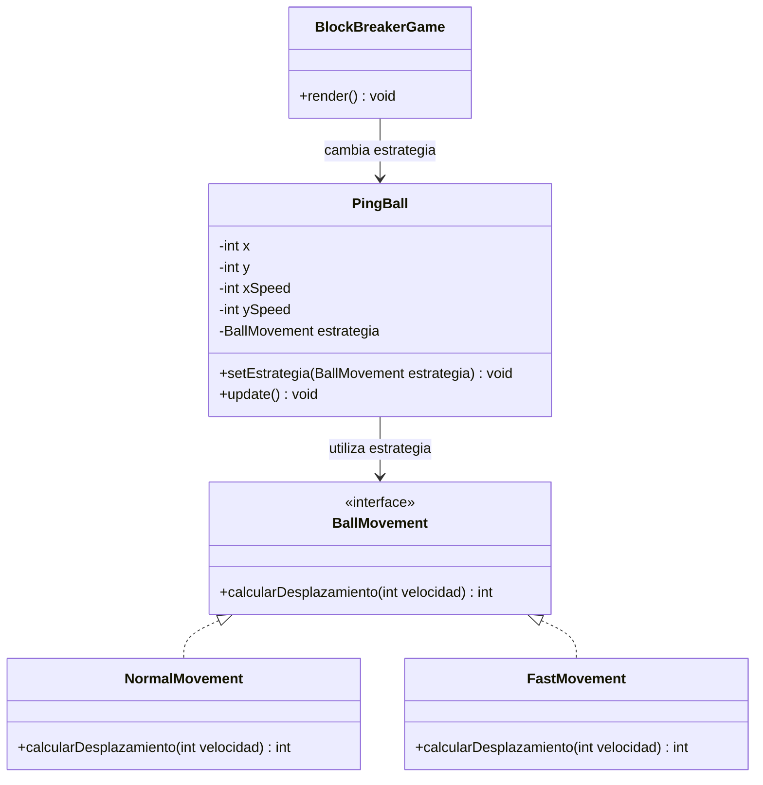
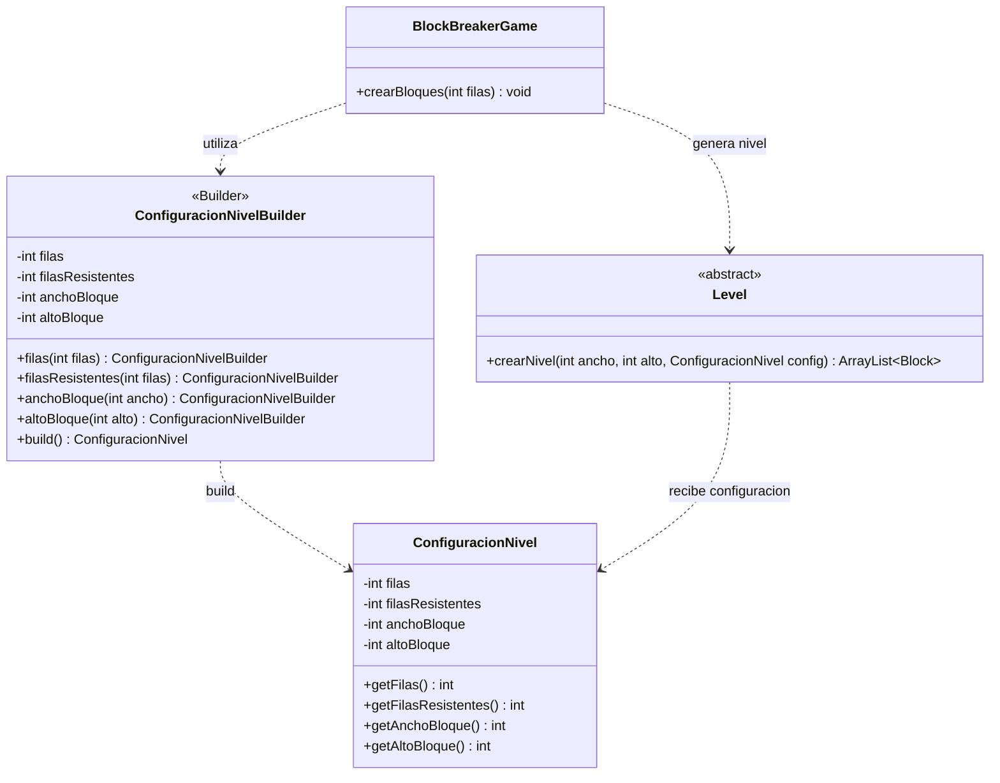

## Singleton

Problema: Necesitábamos controlar las vidas, el puntaje y el nivel del jugador sin crear varios administradores con información diferente.
Contexto: Durante la partida, BlockBreakerGame consulta y actualiza estos datos cuando el jugador pierde una vida, destruye bloques o avanza de nivel.
Solución: Implementamos Singleton mediante GameManager. Su constructor es privado y getInstancia() permite acceder a una única instancia que administra el estado de la partida.Clases involucradas: GameManager y BlockBreakerGame.

## Strategy

Problema: Queríamos permitir distintos movimientos de la pelota sin tener que cambiar su lógica cada vez que modificáramos la velocidad.
Contexto: En BlockBreaker, el jugador puede seleccionar el movimiento normal con la tecla 1 o el rápido con la tecla 2.
Solución: Creamos la interfaz BallMovement y dos implementaciones: NormalMovement y FastMovement. PingBall utiliza una estrategia para calcular su desplazamiento y puede cambiarla mediante setEstrategia().Clases involucradas: BallMovement, NormalMovement, FastMovement, PingBall y BlockBreakerGame.

## Template Method

Problema: Necesitábamos generar niveles con diferentes dificultades sin repetir el algoritmo de creación de bloques.
Contexto: El juego tiene niveles fáciles y difíciles. Ambos utilizan el mismo procedimiento para distribuir los bloques, pero pueden personalizar sus características.
Solución: Creamos la clase abstracta Level, que define el procedimiento mediante crearNivel(). Las clases EasyLevel y HardLevel heredan de ella y personalizan la creación de bloques normales, incluyendo sus colores.Clases involucradas: Level, EasyLevel, HardLevel, Block, NormalBlock y HardBlock.

## Builder

Problema: Necesitábamos configurar diferentes niveles sin escribir directamente todos sus parámetros cada vez que los creábamos.
Contexto: Cada nivel de BlockBreaker puede tener distinta cantidad de filas, filas resistentes y dimensiones de los bloques.
Solución: Implementamos ConfiguracionNivelBuilder, que permite definir estas características paso a paso. El método build() valida los valores y construye un objeto ConfiguracionNivel, que después utiliza Level para generar los bloques.Clases involucradas: ConfiguracionNivelBuilder, ConfiguracionNivel, Level y BlockBreakerGame.

