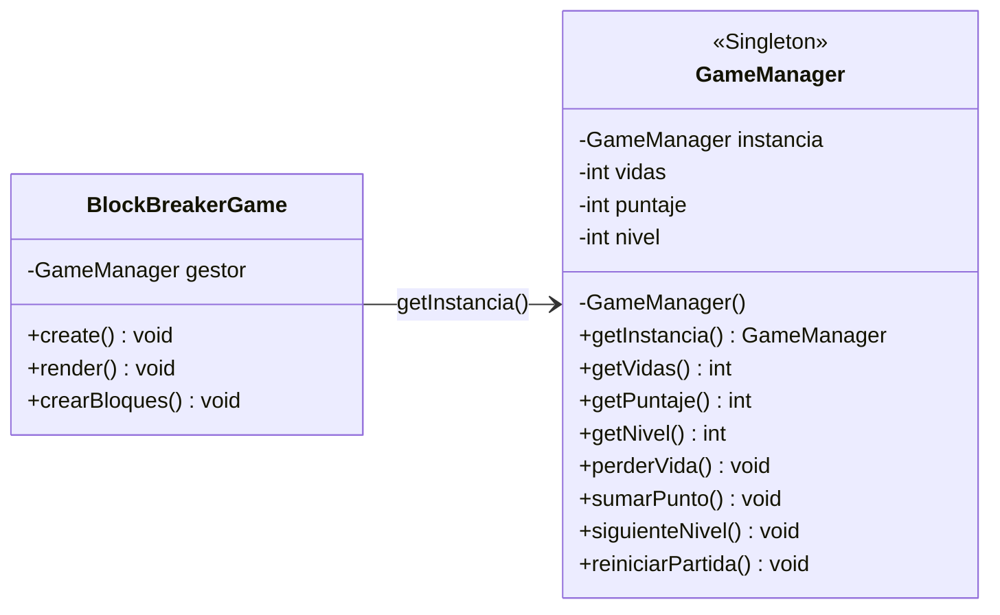
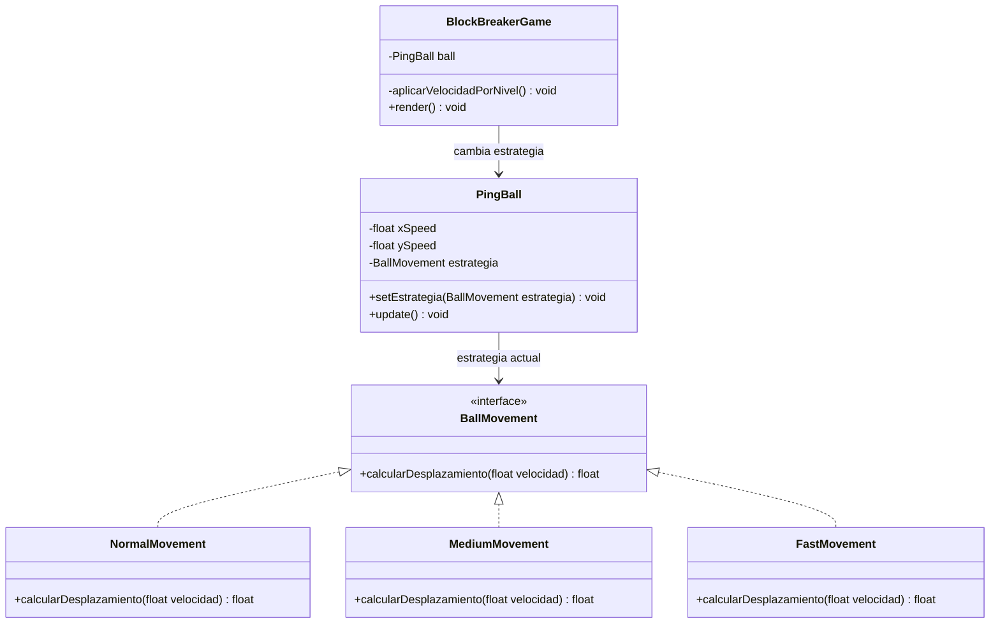
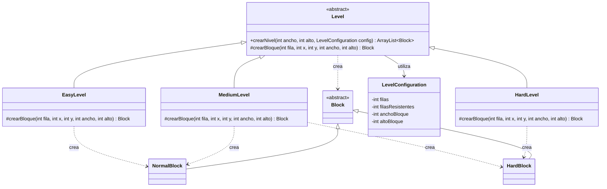
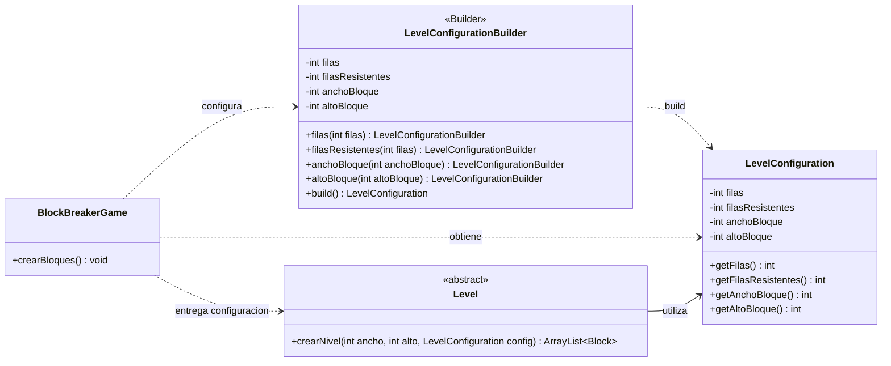

## Singleton

Se aplicó el patrón de diseño creacional Singleton para centralizar el estado de la partida en una única instancia inmutable. Este patrón garantiza que toda la arquitectura del juego consuma la misma referencia de memoria, manteniendo la consistencia de los puntos y las vidas independientemente de los eventos que ocurran en el renderizado.

## Strategy

Se requería gestionar un incremento progresivo de dificultad sin contaminar la clase principal con múltiples sentencias condicionales. Para resolverlo se encapsuló el algoritmo de movimiento utilizando el patrón Strategy,. La pelota PingBall no calcula su propia aceleración, sino que delega este cálculo a una interfaz inyectable. Al cambiar de nivel el gestor central inyecta una nueva estrategia matemática concreta, alterando el comportamiento físico de la pelota en tiempo de ejecución de manera limpia.

## Template Method

La creación de los distintos niveles repetía el mismo procedimiento, variando principalmente el tipo de bloque generado. El juego posee EasyLevel, MediumLevel y HardLevel, los cuales comparten la misma estructura de generación pero tienen comportamientos distintos. Como solución se implementó Level como clase abstracta. Su método final crearNivel() define el algoritmo general, mientras crearBloque() es implementado por cada subclase según la dificultad.

## Builder

Los niveles necesitan varios parámetros de configuración, lo que hacía poco clara su construcción directa. Según el nivel se modifican la cantidad de filas, filas resistentes y dimensiones de los bloques. Como solución se creó LevelConfigurationBuilder, que permite configurar estos valores paso a paso y mediante build() genera un LevelConfiguration validado, utilizado posteriormente por Level.L

